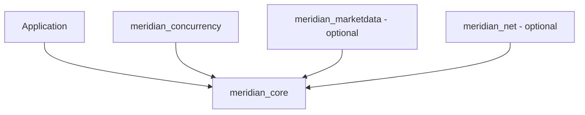

# Meridian

Meridian is a C++20, single-instrument limit order book and matching engine.
It matches limit and market orders by price-time priority, trades at maker
prices, preserves FIFO after partial fills, and emits typed events. The same
input sequence produces the same fills, book state, and event order.

The project develops correctness and determinism before performance: a
single-threaded core, independent oracle tests, measured optimization, a
single-writer concurrent adapter, optional market data and TCP, and recorded
stress/leak checks. It is an in-memory systems-engineering implementation with
[explicit operational limits](docs/known-limitations.md), rather than a complete
exchange service.

## Build and run a complete example

Requirements: CMake 3.20+, a C++20 compiler and standard library, and platform
thread support. CI exercises GCC on Linux and Apple Clang on macOS. Networking
requires POSIX sockets; other platforms are not covered by the current CI.

From the repository root, this builds without downloading benchmark dependencies:

```sh
cmake -S . -B build-docs -DCMAKE_BUILD_TYPE=Release \
  -DMERIDIAN_BUILD_BENCHMARKS=OFF -DMERIDIAN_BUILD_NET=OFF
cmake --build build-docs --parallel
ctest --test-dir build-docs --output-on-failure
```

Compile the checked-in [order-flow example](examples/order_flow.cpp) with a
Clang/GCC driver on Linux or macOS:

```sh
c++ -std=c++20 -Wall -Wextra -Wpedantic -Werror -Iinclude \
  examples/order_flow.cpp build-docs/libmeridian_core.a -o build-docs/order-flow
./build-docs/order-flow
```

Expected output:

```text
maker=2 price=100 quantity=3
maker=3 price=100 quantity=2
maker=1 price=101 quantity=2
best_ask=101 depth=2 events=7
```

The executable `meridian_engine` is currently an empty-book smoke check; it is
not a file-replay CLI. The example above demonstrates actual matching, and the
optional TCP executable below provides interactive order entry.

## What the example means

Prices are signed integer ticks and quantities are unsigned integer units;
the application chooses the economic scale. No floating-point arithmetic is
used for matching. A valid resting limit has positive price/quantity and an ID
not currently resting in that book. ID zero is allowed; filled/cancelled IDs
are reusable. Market orders use price zero by convention, and never rest.

The example inserts these asks in order, then submits buy ID 4 for 7 at 101:

| Maker ID | Ask price | Initial quantity | Execution order | Remaining |
| --- | ---: | ---: | ---: | ---: |
| 1 | 101 | 4 | Third: 2 at 101 | 2 |
| 2 | 100 | 3 | First: 3 at 100 | 0 |
| 3 | 100 | 2 | Second: 2 at 100 | 0 |

Better price takes precedence over arrival time; IDs 2 and 3 then match FIFO.
The partially filled maker 1 retains its place. The aggressor has no remainder.
Its event batch is one acceptance followed by three matched/trade pairs.
A limit remainder would rest at its submitted price; an unfilled market
remainder would be returned and discarded. [Order flows](docs/order-flows.md)
walk through exact events, remainders, cancellation, and amendment priority.

## Architecture and integration choices

The arrows below mean **library dependency**, not one shared running engine:



Core owns all matching/book semantics and knows nothing about sockets,
market-data publishing, or application I/O. The CTest dependency check rejects
core includes of network or market-data headers.

| Interface | Ownership and behavior |
| --- | --- |
| `OrderBook` | Single owner; insert/cancel/modify/reduce/query; no automatic matching |
| `MatchingEngine` | Single owner; limit/market submission, fills, const book access, events |
| `ConcurrentMatchingEngine` | Own engine, unbounded producer queue, one worker, futures, lightweight immutable snapshots |
| `MarketDataPublisher` | Separate event projection; one writer consumes complete batches; readers retain immutable full-depth snapshots |
| `TcpServer` | Own engine shared by loopback clients; one nonblocking event loop; bounded text protocol |

These are separate integration paths. The concurrent adapter and TCP server
own independent engines and do not automatically feed `MarketDataPublisher`.
An application owning a direct engine can drain and fan out complete event
batches to market data. The concurrent adapter exposes no event-drain API;
its event history remains retained until destruction.

Core state uses ordered bid/ask maps, FIFO order lists, and a hash index by ID.
ID lookup averages O(1); cancellation also looks up the price-level map and is
O(log L) on average overall, where L is the number of levels. Partial fills
keep their list position. No custom allocator or lock-free queue is used.
[Architecture](docs/architecture.md), [data structures](docs/data-structures.md),
[memory strategy](docs/memory-strategy.md), and [design decisions](docs/design-decisions.md)
explain ownership, complexity, and the choices behind these boundaries.

## Build options and library use

| CMake option | Default | Effect |
| --- | --- | --- |
| `BUILD_TESTING` | `ON` | CTest targets and `meridian_stress` |
| `MERIDIAN_BUILD_BENCHMARKS` | `ON` | Fetch pinned Google Benchmark 1.9.5; build `meridian_benchmarks` |
| `MERIDIAN_BUILD_MARKETDATA` | `ON` | Build `meridian_marketdata` |
| `MERIDIAN_BUILD_NET` | `OFF` | POSIX `meridian_net` and `meridian_tcp_server` |
| `MERIDIAN_ENABLE_SANITIZERS` | `OFF` | ASan + UBSan compile/link instrumentation |
| `MERIDIAN_ENABLE_TSAN` | `OFF` | TSan instrumentation; mutually exclusive with ASan/UBSan |

Core and production executables have no third-party dependency. Benchmark
fetching requires Git and network access (or a populated CMake dependency cache).
For an embedded/offline build, disable benchmarks and optionally tests,
market data, and networking. `meridian_concurrency` still exists as a separate
target; building `meridian_core` does not build that adapter.

A parent CMake application can `add_subdirectory` this checkout and link
`meridian_core`, `meridian_concurrency`, `meridian_marketdata`, or `meridian_net`.
Headers are under `include/meridian/`. Set the build options before adding the
subdirectory. No installed package/export target is supplied. See the
[contributor guide](docs/contributing.md) for exact recipes, sanitizers, and checks.

## Try TCP order entry

Build and start the loopback server in one terminal:

```sh
cmake -S . -B build-net -DCMAKE_BUILD_TYPE=Release \
  -DMERIDIAN_BUILD_BENCHMARKS=OFF -DMERIDIAN_BUILD_NET=ON
cmake --build build-net --parallel
./build-net/meridian_tcp_server 9000
```

In another terminal, run `nc 127.0.0.1 9000`, enter `LIMIT 1 SELL 100 3`,
then `LIMIT 2 BUY 100 2`, then `BOOK`. The responses are:

```text
OK 1 3 0
END
OK 2 0 1
FILL 2 1 100 2
END
BOOK NONE 100 1
```

The server supports `LIMIT`, `MARKET`, `BOOK`, and `PING`. A complete request
can execute before a response is lost: disconnecting does not roll back fills,
and retries are not exactly-once. Bounds, framing, shutdown, and delivery
semantics are specified in the [network protocol](docs/network-protocol.md).

## Correctness and stress evidence

Tests cover price/FIFO rules, partial/multiple fills, modification priority,
invalid inputs, event ordering, seeded replay, independent matching oracles,
quantity conservation, concurrent ownership, market-data projection, and socket
failure handling. With both optional layers enabled there are 16 CTest entries;
without networking there are 13. The build uses warnings as errors.

For a bounded soak after the quick-start build:

```sh
./build-docs/meridian_stress --mode both --seconds 300 --seed 8675309
```

Recorded evidence includes a five-minute local ASan/UBSan soak checking
168,066,080 direct events, plus Linux Release and ASan/UBSan/LeakSanitizer soaks.
The oracle checks every direct event field/position. Concurrent checks verify
fills, futures, and snapshots, rather than claiming access to the private event
log. CI runs normal/sanitized builds and 120-second soaks. These minute-scale
runs are not multi-hour production qualification. See the [test matrix](docs/test-matrix.md),
[stress methodology](docs/stress-testing.md), and [raw results](docs/stress-results.md).

## Performance evidence

On an Apple M3, macOS 27.0, Apple Clang 21, Release, the paired five-repetition
Google Benchmark comparison measured a 1,000-maker single-level sweep at
2.086 ms before and 72.17 microseconds after removing repeated level copies
(**28.91x**). The algorithm copies one FIFO head per fill instead of the whole
remaining level. A longer confirmation measured 52.79 microseconds; settings
and variation are retained with the original run.

Separate 60-second instrumented Release stress profiles on that host reported:

| Measurement | Recorded value | Boundary |
| --- | ---: | --- |
| Direct verified workload throughput | 1.91 million submissions/s | Includes generation, oracle, and event checking |
| Direct submit p99 | 459 ns upper bound | Includes rejected orders; excludes oracle/drain work |
| Concurrent completion p99 | 24,575 ns upper bound | Four closed-loop producers; includes queue/snapshot/future work |

These workloads are different measurements. Batch CPU averages are not request
latency percentiles; neither is a network-latency or open-loop service-level
guarantee. Tail maxima and background-load limits are recorded. Reproduction
commands, before/after revisions, raw JSON, and interpretation are in
[benchmark methodology](docs/benchmark-methodology.md),
[benchmark results](docs/benchmark-results.md), and [stress results](docs/stress-results.md).

## Operational limits and reading guide

Meridian has one volatile instrument per engine instance, with no persistence,
journal recovery, authentication, durable retry identity, or multi-instrument
routing. `OrderBook` supports cancellation/modification directly; engine and
adapter submission APIs do not expose those commands. Direct book edits can
create a crossed book because they do not invoke matching.

The concurrent queue and event history are unbounded. Core aggregate quantity
and sequence arithmetic has no overflow admission policy; allocation-failure
recovery is unsupported. TCP applies its own order/quantity/buffer bounds but
is loopback-only. Market data requires a complete ordered feed from an empty
source and has no gap-recovery protocol. These boundaries and potential next
work are detailed in [known limitations](docs/known-limitations.md).

| Read next | Purpose |
| --- | --- |
| [Architecture](docs/architecture.md) | Dependencies, runtime ownership, execution sequence |
| [Matching](docs/matching-algorithm.md) and [order flows](docs/order-flows.md) | Rules and concrete examples |
| [Events](docs/events.md) and [modification](docs/order-modification.md) | Emission and priority contracts |
| [Concurrency](docs/concurrency-model.md) and [market data](docs/market-data.md) | Worker and reader lifetimes, event projection |
| [Data structures](docs/data-structures.md) and [memory](docs/memory-strategy.md) | Complexity, allocations, retention |
| [Contributing](docs/contributing.md) and [AGENTS.md](AGENTS.md) | Build, validation, branch/commit rules |
