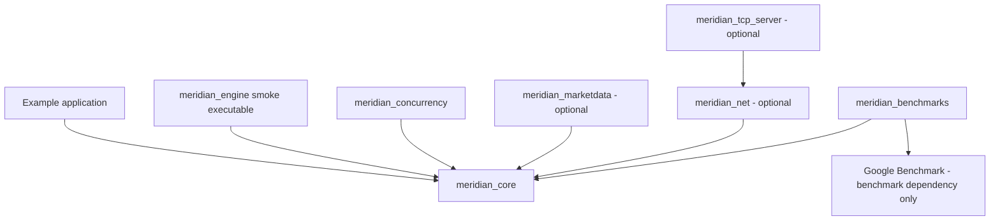
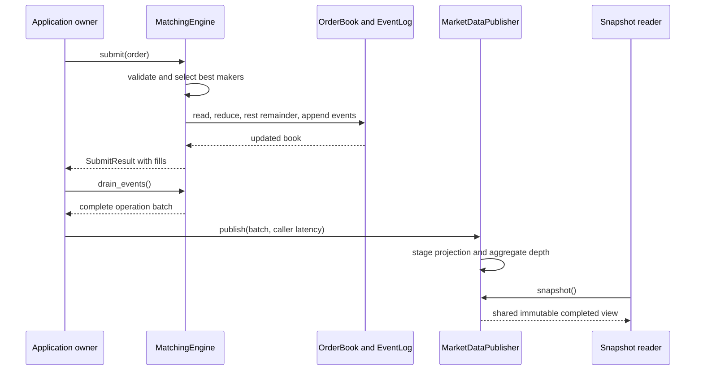

# Architecture

Meridian separates matching semantics from execution adapters and derived views.
All orders belong to one instrument per engine instance. Core has no sockets,
application I/O, clocks, or market-data dependency.

## Build dependencies

Arrows mean "links/depends on", not runtime event flow:

`meridian_core` builds `src/book/order_book.cpp` and
`src/engine/matching_engine.cpp`. Types, orders, and events live in public
headers. The target does not link the outer adapters. All public headers mirror
module names under `include/meridian/`. The CTest layering script rejects
network/market-data includes in core modules; it is a direct-include check,
not a complete transitive dependency analyzer.

Market data uses the header-only `SnapshotStore` utility from the concurrency
header directory, not the worker/queue library. It has no runtime dependency
on `ConcurrentMatchingEngine`. CMake discovers platform threads for the separate
adapter targets even when only core will be built.

## Runtime ownership

| Path | Owns | Publishes/returns | Consumption policy |
| --- | --- | --- | --- |
| Direct `MatchingEngine` | One `OrderBook` and its event log | `SubmitResult`, const book, event batches | Application drains/fans out events |
| `ConcurrentMatchingEngine` | Its own engine, inbound queue, worker | Future results and lightweight snapshots | Worker retains private event history |
| `TcpServer` / `ProtocolSession` | Its own engine and client descriptors | Text responses to submitting clients | Session drains/discards events after submission |
| `MarketDataPublisher` | Its own resting-order projection | Full-depth immutable snapshots and counters | Receives source batches from application |

Instantiating these paths creates distinct engine instances; they do not share
liquidity. The TCP server does not forward into the concurrent adapter, and
neither adapter exposes an event feed to market data. Integration happens at
an application-owned boundary, not by reversing core dependencies.

A direct application's event flow is:

The reader sees the last successfully published view, which can lag matching
until the application publishes. No callback runs from the matching core.
Batch boundaries matter: acceptance of an aggressive limit precedes fills,
so publishing between individual events could expose transient crossed depth.

## Domain and matching

`OrderId`, `Price`, and `Qty` are explicit value wrappers. `Side` and `OrderType`
are scoped enums. Wrappers prevent accidental type mixing but do not validate
construction; the book/engine validate submissions. Matching uses integer ticks
and units, never floating-point prices. Market price is ignored; examples use 0.

Each side has an ordered price map; each level has a FIFO list plus aggregate
quantity. The ID index stores a list iterator, side, and price. The engine picks
the best opposing FIFO head, copies that order by value, fills at maker price,
and reduces/removes the source node. That local copy remains valid for event
emission after full-fill erasure. Results are deterministic for the concrete
input sequence; concurrency does not define an ordering between racing producers.

`MatchingEngine::book()` is const. Direct book cancellation/modification is
available to book owners, not through the engine/worker/TCP submission APIs.
Price-changing book edits do not perform matching. See
[matching-algorithm.md](matching-algorithm.md) and [order-flows.md](order-flows.md).

## Why these boundaries

- A single mutable owner makes matching order and iterator ownership explicit;
  queue synchronization does not enter core matching.
- Typed value events allow an independent market-data projection without
  protocol or reader concerns in core.
- Standard containers establish the measured baseline and preserve simple
  ownership. The implemented optimization removes repeated copies; pools and
  lock-free structures remain unimplemented without workload evidence.
- Separate optional targets make network/market-data exclusion verifiable.

The [decision record](design-decisions.md) captures the choices; the
[memory strategy](memory-strategy.md) and [known limits](known-limitations.md)
state their operational costs. This architecture defines an inspectable engine
and adapters, not a persistence/recovery or exchange operations architecture.
